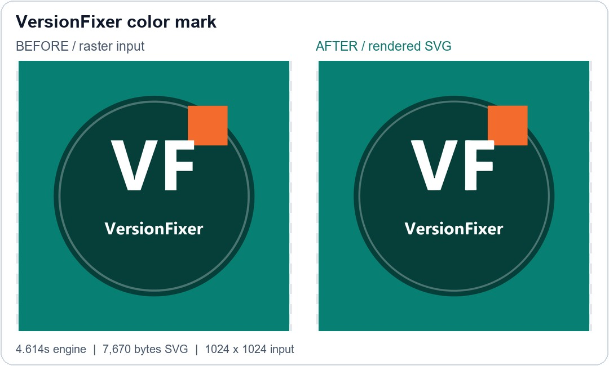
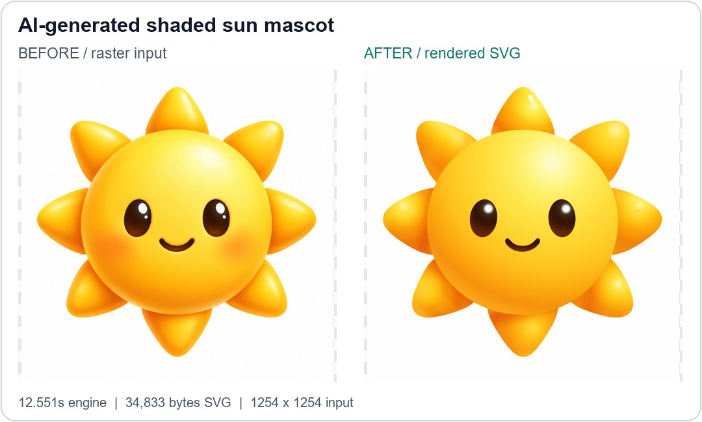
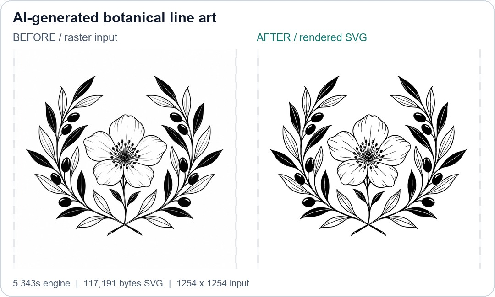
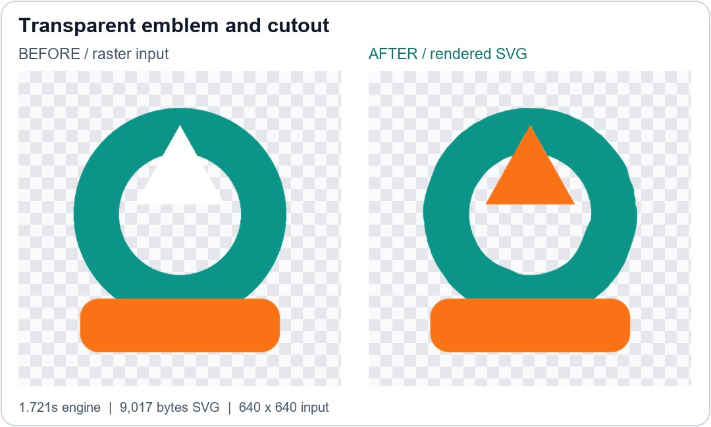
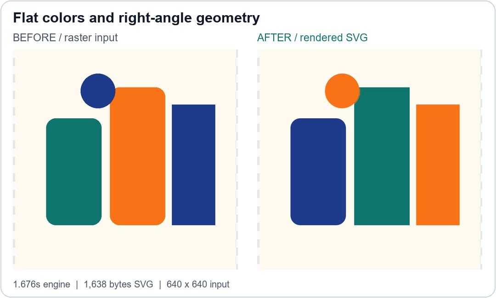
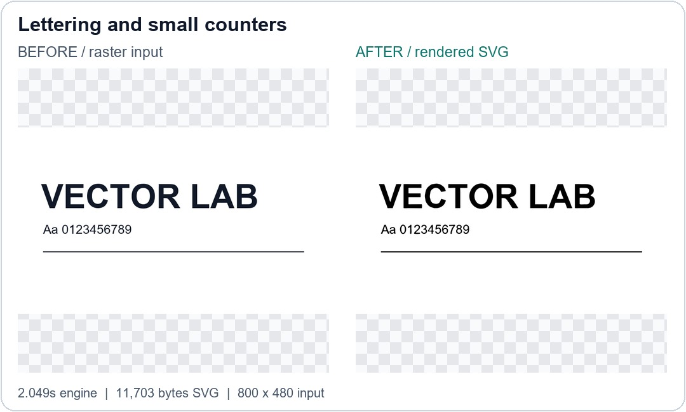
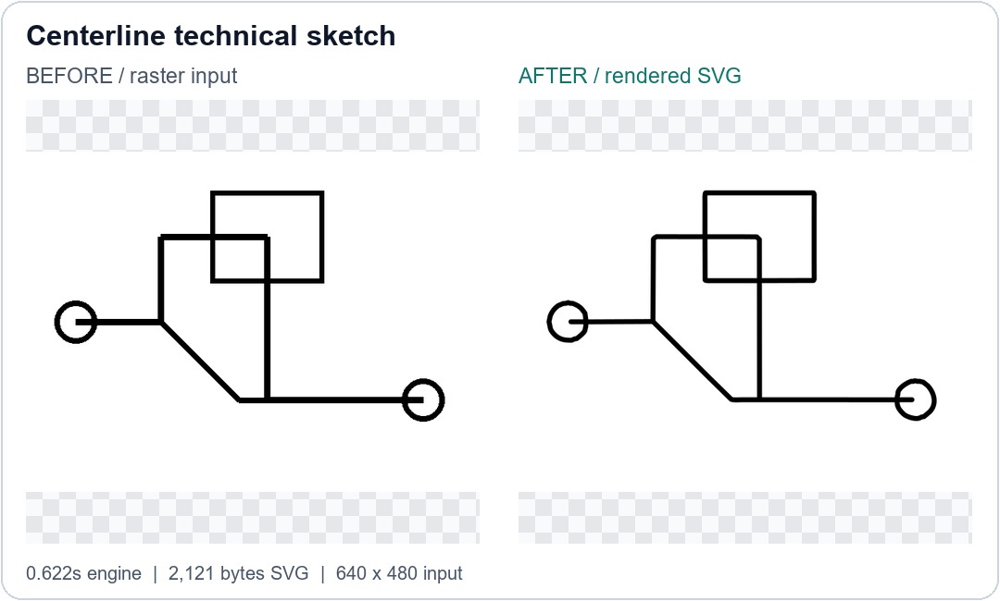
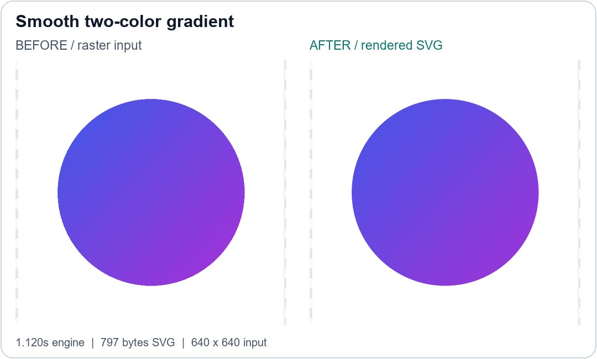
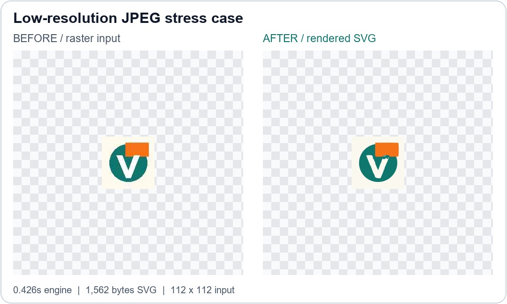

# Ten-image TrueVector V6.2 demonstration

[Back to VersionFixer](README.md) · [العربية](README.ar.md) · [Try your first image free](https://versionfixer.com/en/vector/?utm_source=github&utm_medium=gallery&utm_campaign=truevector_showcase)

**Test date: 25 October 2026.** Every output below came from an actual conversion by the deployed service. No competitor was tested and no after-image was manually retouched. This is a small illustrative set, not a representative or independent performance study.

## Results at a glance

| Case | Engine time | Observed cloud round trip | SVG size | Review note |
|---|---:|---:|---:|---|
| [VersionFixer badge](#01-versionfixer-badge) | 5.532s | 15.869s | 7,246 B | Inspect example |
| [VersionFixer color mark](#02-versionfixer-mark) | 4.614s | 14.511s | 7,670 B | Inspect example |
| [AI-generated shaded sun mascot](#03-ai-sun-mascot) | 12.551s | 22.201s | 34,833 B | Review needed |
| [AI-generated botanical line art](#04-ai-botanical) | 5.343s | 15.904s | 117,191 B | Inspect example |
| [Transparent emblem and cutout](#05-transparent-emblem) | 1.721s | 7.458s | 9,017 B | Review needed |
| [Flat colors and right-angle geometry](#06-flat-palette) | 1.676s | 7.372s | 1,638 B | Review needed |
| [Lettering and small counters](#07-lettering) | 2.049s | 7.643s | 11,703 B | Inspect example |
| [Centerline technical sketch](#08-centerline-drawing) | 0.622s | 7.325s | 2,121 B | Special centerline mode |
| [Smooth two-color gradient](#09-smooth-gradient) | 1.120s | 7.704s | 797 B | Inspect example |
| [Low-resolution JPEG stress case](#10-low-resolution-jpeg) | 0.426s | 17.145s | 1,562 B | Review needed |

## How to interpret this comparison

- Ten images were processed once each, sequentially, using explicit UI-equivalent settings. The inputs include VersionFixer artwork, two AI-generated images and six controlled fixtures. There are no private customer files.
- “Before” files are the actual raster inputs; “after” PNGs are rendered from the actual SVG. The side-by-side cards only add labels and resize the views; checkerboards are display aids.
- Engine time is reported processing time. Observed cloud round trip includes submission, startup/queueing, transfer and polling; it is not a guaranteed customer response time or a precise startup breakdown.
- The implementation measured here computes on CPU. A T4 was available on the cloud host, but CUDA computation was not used. Median engine time was 1.885s, range 0.426–12.551s, for these specific images.
- The existing resource guard normalizes inputs above one megapixel before tracing. Source/output dimensions are shown per case; SVG remains vector output, but normalization can affect small details.
- Independent RGB MAE is the mean absolute RGB difference on a 0–1 scale after compositing transparency on white and matching output size to input with Lanczos. Lower is better; it is not an accuracy percentage.
- Independent Edge F1 uses a grayscale edge threshold and one-pixel tolerance after size matching. Higher is better. It is sensitive to source resolution, thresholds and styling; it does not establish editability, topology, print readiness or exact color fidelity.
- The engine also has its own quality gates, which use a different internal comparison target. A gate pass must not be advertised as perfect source fidelity. The forced-palette test demonstrates this distinction.
- Centerline mode intentionally produces strokes instead of matching filled areas. Filled-shape gates are marked N/A for that case; its SVG must be reviewed for the intended cutting/drawing workflow.

## Complete gallery

### VersionFixer badge

[Original PNG](assets/01-versionfixer-badge-before.png) · [SVG output](assets/01-versionfixer-badge-result.svg) · [PNG rendered from SVG](assets/01-versionfixer-badge-after.png)

- **Input:** 1254×1254; output canvas 1000×1000.
- **Origin:** User-provided VersionFixer artwork.
- **Settings:** Default automatic settings.
- **Time:** 5.532s engine; 15.869s observed round trip.
- **Independent source comparison:** RGB MAE 0.00496; Edge F1 0.92315.
- **Engine gate:** PASS (not a fidelity guarantee).
- **Observation:** Clean badge result; subtle shading is simplified. Review small lettering.
- **Test note:** Soft shading and lettering. The source is normalized to a 1-megapixel working image by the production guard.

### VersionFixer color mark

[Original PNG](assets/02-versionfixer-mark-before.png) · [SVG output](assets/02-versionfixer-mark-result.svg) · [PNG rendered from SVG](assets/02-versionfixer-mark-after.png)

- **Input:** 1024×1024; output canvas 1000×1000.
- **Origin:** VersionFixer project-owned test asset.
- **Settings:** Default automatic settings.
- **Time:** 4.614s engine; 14.511s observed round trip.
- **Independent source comparison:** RGB MAE 0.00123; Edge F1 0.97070.
- **Engine gate:** PASS (not a fidelity guarantee).
- **Observation:** Strong color-mark result; compare fine edges at zoom.
- **Test note:** Inspect the original and output rather than relying only on a summary score.

### AI-generated shaded sun mascot

[Original PNG](assets/03-ai-sun-mascot-before.png) · [SVG output](assets/03-ai-sun-mascot-result.svg) · [PNG rendered from SVG](assets/03-ai-sun-mascot-after.png)

- **Input:** 1254×1254; output canvas 1000×1000.
- **Origin:** AI-generated test input; not customer artwork.
- **Settings:** color_mode=gradients, gradient_mode=on.
- **Time:** 12.551s engine; 22.201s observed round trip.
- **Independent source comparison:** RGB MAE 0.01260; Edge F1 0.83868.
- **Engine gate:** REVIEW — quality gate not met.
- **Observation:** REVIEW: internal quality gate not met. Shading, face details and highlights need inspection.
- **Test note:** A deliberately difficult shaded input. Look for changes in lighting, highlights and facial details, not just silhouette.

### AI-generated botanical line art

[Original PNG](assets/04-ai-botanical-before.png) · [SVG output](assets/04-ai-botanical-result.svg) · [PNG rendered from SVG](assets/04-ai-botanical-after.png)

- **Input:** 1254×1254; output canvas 1000×1000.
- **Origin:** AI-generated test input; not customer artwork.
- **Settings:** color_mode=black_and_white, gradient_mode=off.
- **Time:** 5.343s engine; 15.904s observed round trip.
- **Independent source comparison:** RGB MAE 0.01625; Edge F1 0.95837.
- **Engine gate:** PASS (not a fidelity guarantee).
- **Observation:** Good line-art outline; inspect the thinnest veins and small gaps.
- **Test note:** Thin internal lines and small gaps are the challenging details.

### Transparent emblem and cutout

[Original PNG](assets/05-transparent-emblem-before.png) · [SVG output](assets/05-transparent-emblem-result.svg) · [PNG rendered from SVG](assets/05-transparent-emblem-after.png)

- **Input:** 640×640; output canvas 640×640.
- **Origin:** Controlled geometric test fixture.
- **Settings:** transparent_bg=keep, num_colors=3, gradient_mode=off.
- **Time:** 1.721s engine; 7.458s observed round trip.
- **Independent source comparison:** RGB MAE 0.01962; Edge F1 0.89046.
- **Engine gate:** PASS (not a fidelity guarantee).
- **Observation:** REVIEW: native alpha/cutouts remain, but the three-color setting changed the white foreground triangle to orange. Use the source and SVG to inspect color fidelity.
- **Test note:** Native transparent input. Checkerboard is display-only and is not baked into the SVG.

### Flat colors and right-angle geometry

[Original PNG](assets/06-flat-palette-before.png) · [SVG output](assets/06-flat-palette-result.svg) · [PNG rendered from SVG](assets/06-flat-palette-after.png)

- **Input:** 640×640; output canvas 640×640.
- **Origin:** Controlled geometric test fixture.
- **Settings:** color_mode=custom_palette, custom_colors_hex=#fffaf0, #0f766e, #f97316, #1e3a8a, num_colors=4, gradient_mode=off.
- **Time:** 1.676s engine; 7.372s observed round trip.
- **Independent source comparison:** RGB MAE 0.14828; Edge F1 0.96313.
- **Engine gate:** PASS (not a fidelity guarantee).
- **Observation:** REVIEW: shape gate passed but custom-palette color fidelity is visibly limited (RGB MAE 0.1483).
- **Test note:** Custom palette and shape preservation; this is not a customer logo.

### Lettering and small counters

[Original PNG](assets/07-lettering-before.png) · [SVG output](assets/07-lettering-result.svg) · [PNG rendered from SVG](assets/07-lettering-after.png)

- **Input:** 800×480; output canvas 800×480.
- **Origin:** Controlled typography test fixture.
- **Settings:** color_mode=black_and_white, gradient_mode=off.
- **Time:** 2.049s engine; 7.643s observed round trip.
- **Independent source comparison:** RGB MAE 0.00654; Edge F1 1.00000.
- **Engine gate:** PASS (not a fidelity guarantee).
- **Observation:** Lettering becomes paths, not editable font text. Compare small counters.
- **Test note:** The output is traced outlines, not recovered editable font text. Inspect small letter counters.

### Centerline technical sketch

[Original PNG](assets/08-centerline-drawing-before.png) · [SVG output](assets/08-centerline-drawing-result.svg) · [PNG rendered from SVG](assets/08-centerline-drawing-after.png)

- **Input:** 640×480; output canvas 640×480.
- **Origin:** Controlled line-network test fixture.
- **Settings:** color_mode=black_and_white, path_mode=centerline, gradient_mode=off, centerline_stroke_width=7.0.
- **Time:** 0.622s engine; 7.325s observed round trip.
- **Independent source comparison:** RGB MAE 0.00906; Edge F1 0.95811.
- **Engine gate:** N/A — centerline workflow.
- **Observation:** SPECIAL MODE: single-line extraction; filled-mask gates are not a suitable pass/fail standard.
- **Test note:** Centerline extraction intentionally changes filled stroke geometry; similarity scores are not a fabrication-readiness certificate.

### Smooth two-color gradient

[Original PNG](assets/09-smooth-gradient-before.png) · [SVG output](assets/09-smooth-gradient-result.svg) · [PNG rendered from SVG](assets/09-smooth-gradient-after.png)

- **Input:** 640×640; output canvas 640×640.
- **Origin:** Controlled gradient test fixture.
- **Settings:** color_mode=gradients, gradient_mode=on.
- **Time:** 1.120s engine; 7.704s observed round trip.
- **Independent source comparison:** RGB MAE 0.00169; Edge F1 1.00000.
- **Engine gate:** PASS (not a fidelity guarantee).
- **Observation:** Good smooth-gradient result on this controlled input.
- **Test note:** Inspect whether the smooth color transition remains a gradient rather than many bands.

### Low-resolution JPEG stress case

[Original PNG](assets/10-low-resolution-jpeg-before.png) · [SVG output](assets/10-low-resolution-jpeg-result.svg) · [PNG rendered from SVG](assets/10-low-resolution-jpeg-after.png)

- **Input:** 112×112; output canvas 112×112.
- **Origin:** Controlled compressed raster test fixture.
- **Settings:** auto_deblock_jpeg=True.
- **Time:** 0.426s engine; 17.145s observed round trip.
- **Independent source comparison:** RGB MAE 0.03171; Edge F1 0.72938.
- **Engine gate:** PASS (not a fidelity guarantee).
- **Observation:** REVIEW: compression and 112px source limit fine-detail recovery; source-comparison edge F1 is 0.7294.
- **Test note:** 112×112 raster with JPEG artifacts, decoded losslessly to PNG for the test. No missing detail can be guaranteed to be recovered.

## Try it and give useful feedback

[Try image → SVG](https://versionfixer.com/en/vector/?utm_source=github&utm_medium=gallery&utm_campaign=truevector_showcase). One completed image is free per account; later image conversions cost 30 site points. This repository does not expand that offer to ten free conversions.

Report the input dimensions, chosen settings and the exact feature that changed. Do not post confidential or unauthorized artwork in public GitHub issues. For private files, use [VersionFixer support](https://versionfixer.com/en/contact/).

These sample outputs are not the engine source. No source code, notebooks, weights or deployment credentials are published.
