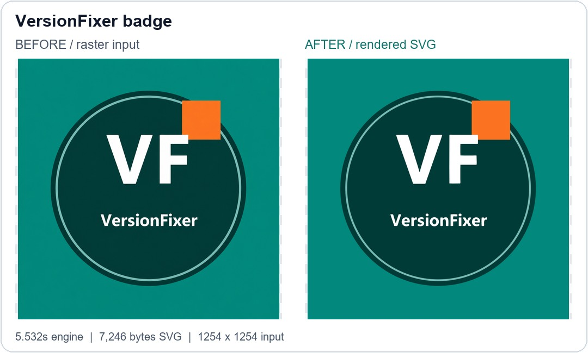

# VersionFixer — تعريف الموقع ومعرض النتائج

[English](README.md) · [جرّب تحويل صورة إلى فيكتور](https://versionfixer.com/ar/vector/?utm_source=github&utm_medium=profile&utm_campaign=truevector_showcase) · [التجارب العشر](BENCHMARK.md)

VersionFixer منصة للتعامل مع توافق ملفات التصميم والطباعة والهندسة، وبها محرك **TrueVector V6.2** لتحويل الصور المناسبة إلى مسارات SVG قابلة للتعديل في محررات الفيكتور.

## جرّب بنفسك

**أول تحويل صورة مكتمل مجاني مرة واحدة لكل حساب. كل تحويل صورة بعده يكلف 30 نقطة من نقاط الموقع.** راجع السعر المعروض قبل الإرسال. هذا عرض تجربة صورة واحدة، وليس استخدامًا مجانيًا بلا حدود أو فترة زمنية محددة لم يُعلن عنها.

ارفع PNG أو JPG أو WebP تملك حق معالجتها، وحدد إعدادات الألوان والخلفية والرسم، ثم قارن المعاينة ونزّل SVG. تقدر تفتحه في Illustrator أو محرر فيكتور مناسب لمراجعة المسارات وتعديلها.

الحد الحالي للصور **20 MiB** وألا يزيد أي ضلع عن **5000 بكسل**. قد تُصغَّر الصور الكبيرة داخليًا لحماية موارد المعالجة.

## نتائج فعلية، مش صور «بعد» مصممة يدويًا

اختبرنا عشر صور على المحرك المنشور يوم **25 أكتوبر 2026**. اليسار هو الأصل النقطي، واليمين معاينة مرسومة فعلًا من SVG الناتج.

مثال بارز من الاختبار — صورة VersionFixer الأصلية وبجانبها معاينة SVG الفعلي:

في [تقرير المقارنات الكامل](BENCHMARK.md) هتلاقي كل صورة أصلية والناتج وSVG والوقت والملاحظات. الصور مزيج من رسومات VersionFixer وصورتين مولدتين بالذكاء الاصطناعي وستة اختبارات مُنشأة للتحقق؛ مش أعمال عملاء أو اختبارًا مستقلًا ممثلًا لكل الاستخدامات، ومش مقارنة بمواقع منافسة.

النتائج القوية لا تعني إن كل الصور مضمونة: الشعار ثلاثي الأبعاد احتاج مراجعة، وإجبار ألوان محددة غيّر توزيع بعض الألوان. وضع Centerline يُقيَّم حسب الغرض منه، وليس بتطابق المساحات الممتلئة فقط.

## إمكانيات محرك الصور

- تحويل اللوجوهات والأيقونات والرسومات المناسبة إلى مسارات SVG.
- إعدادات للألوان، الأبيض والأسود، الرمادي، التدرجات ولوحة الألوان المخصصة.
- خيارات للخلفية والشفافية وتجميع الأشكال.
- مسارات ممتلئة أو خطوط مركزية أو الاثنين حسب الاختيار.
- تنزيل SVG ومعاينة PNG من الموقع.

ده تحويل لمسارات؛ مش استرجاع ملف AI الأصلي بطبقاته، ومش تحويل الكتابة تلقائيًا لنص قابل للتعديل بخطه الأصلي. الصور المشوشة والنصوص الصغيرة والمؤثرات المعقدة قد تحتاج تعديلًا يدويًا.

## خدمات الموقع الأخرى

الكتالوج يشمل مسارات للتصميم والطباعة وملفات Illustrator وCorelDRAW وPhotoshop وInDesign وPDF، وتوافق DWG/DXF، وSketchUp و3ds Max وBlender وCinema 4D، ومشروعات Premiere وAfter Effects وResolve، وأدوات للمجسمات والصوت والبيانات وEPUB والخطوط.

**التوفر مرتبط بالصيغة والهدف والعامل المطلوب.** اختبار الصور هنا لا يثبت نجاح كل خدمة أخرى. Revit وSolidWorks ما زالتا معروضتين «قريبًا» في الكتالوج الحالي، ولا نعتبرهما خدمتين جاهزتين في هذا العرض.

[تصفح الأدوات](https://versionfixer.com/ar/tools/) · [الأسعار](https://versionfixer.com/ar/pricing/) · [تواصل معنا](https://versionfixer.com/ar/contact/)

في هذه العينة تراوح وقت المعالجة بين **0.426 و12.551 ثانية**، والوسيط **1.885 ثانية**. وقت الوصول الكامل يزيد بسبب بدء الخدمة والنقل والانتظار. القياس كان لمعالجة CPU؛ توفر كارت بالسيرفر لا يعني استخدام CUDA.

## السورس يظل خاصًا

المستودع للتعريف والنتائج فقط. **لا يحتوي على كود المحرك أو أوزانه أو Notebooks أو ملفات نشر أو مفاتيح وصول أو نتائج عملاء خاصة.** ملفات SVG المعروضة هي نواتج التجربة، وليست سورس المحرك.

جرّب أول صورة مجانية وقل لنا الملاحظة المحددة. لا ترفع ملفات عملاء سرية على GitHub؛ استخدم دعم الموقع للملفات الخاصة. [مصادر صور الاختبار وحقوقها](ASSET_PROVENANCE.md).
